# Somnium Engine: Lucid

Lucid is the open-world fork of [Somnium Engine](https://github.com/ReanSchwarzer1/SomniumEngine), a 3D game engine and
editor written from scratch in Rust on [`wgpu`](https://wgpu.rs). The renderer, editor, runtime UI, asset pipeline and
game framework are one native workspace. Lucid is developed alongside two games that are not part of this
repository: **Sunscar**, a first-person, photo-real, far-future post-apocalyptic open world, and **Rimeborn**, an
isometric RPG.

> **Status:** pre-1.0, a single-author research project, developed and tested on Windows only. APIs, file formats and
> defaults change often. Expect rough edges.

<p align="center">
  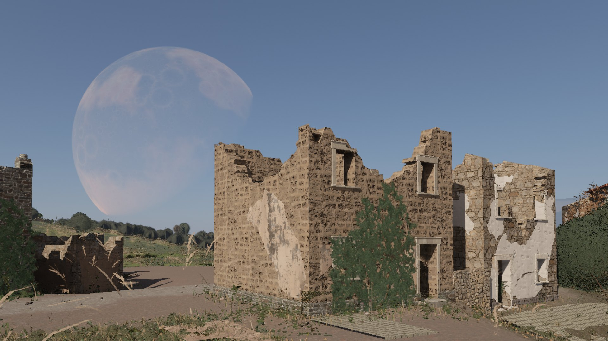
</p>
<p align="center"><em>Sunscar: the ruined village of Lucara under the planet at noon. Every picture here is from the
running game or editor, 27 and 28 November 2026.</em></p>

<table>
  <tr>
    <td width="50%">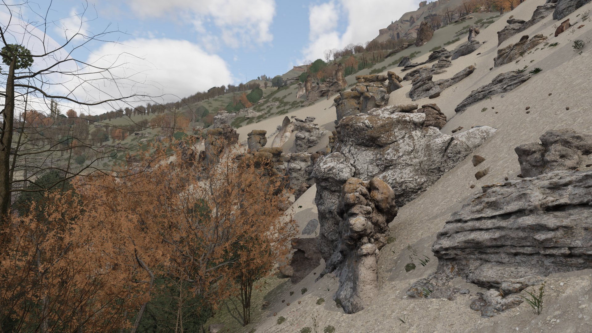</td>
    <td width="50%">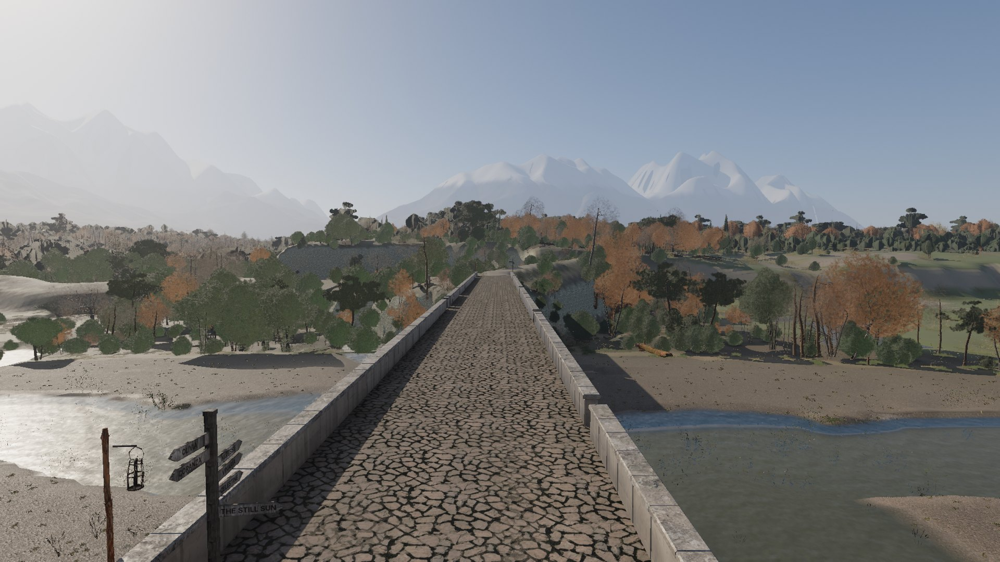</td>
  </tr>
  <tr>
    <td><em>Scanned limestone set into the chalk scarp west of the Play start.</em></td>
    <td><em>The Royal Road crosses the Aurel.</em></td>
  </tr>
  <tr>
    <td width="50%">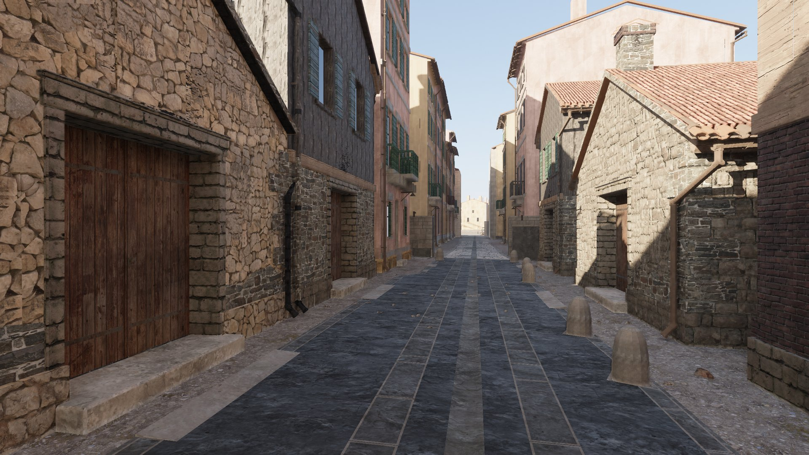</td>
    <td width="50%">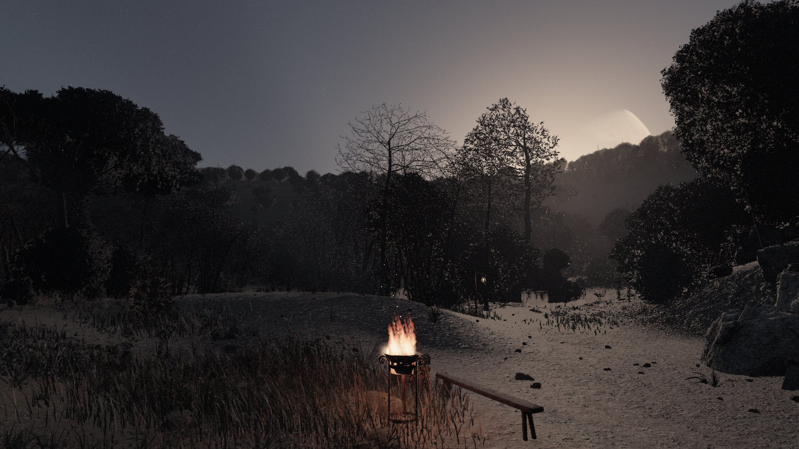</td>
  </tr>
  <tr>
    <td><em>The smiths' row in Monargent, the city.</em></td>
    <td><em>Night: a brazier's flames and embers.</em></td>
  </tr>
</table>

<table>
  <tr>
    <td width="50%">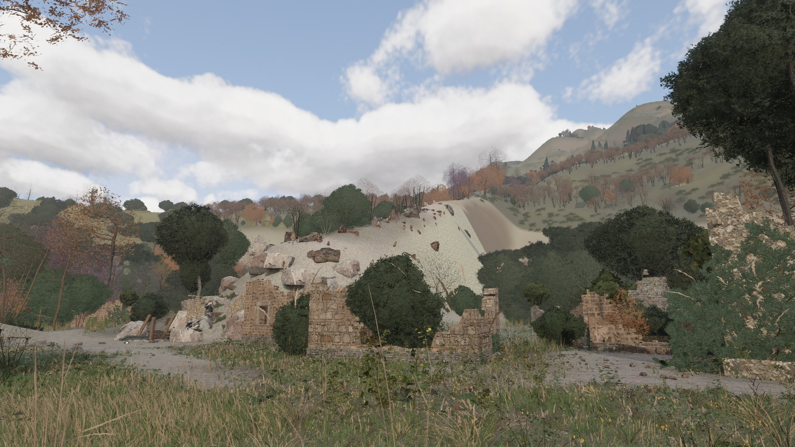</td>
    <td width="50%">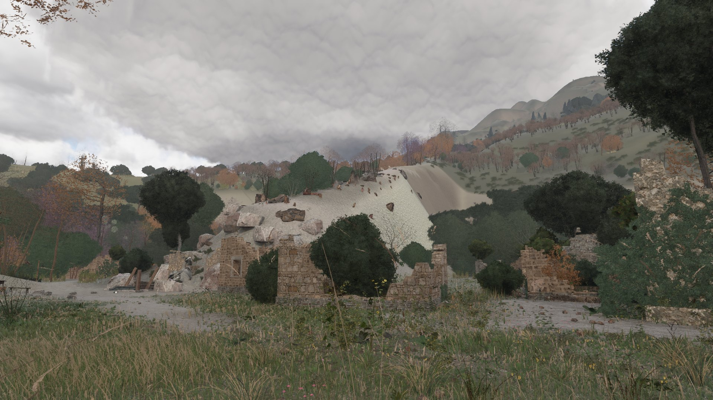</td>
  </tr>
  <tr>
    <td width="50%">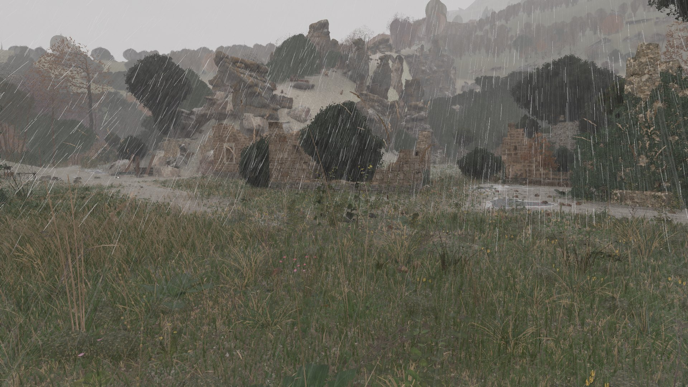</td>
    <td width="50%">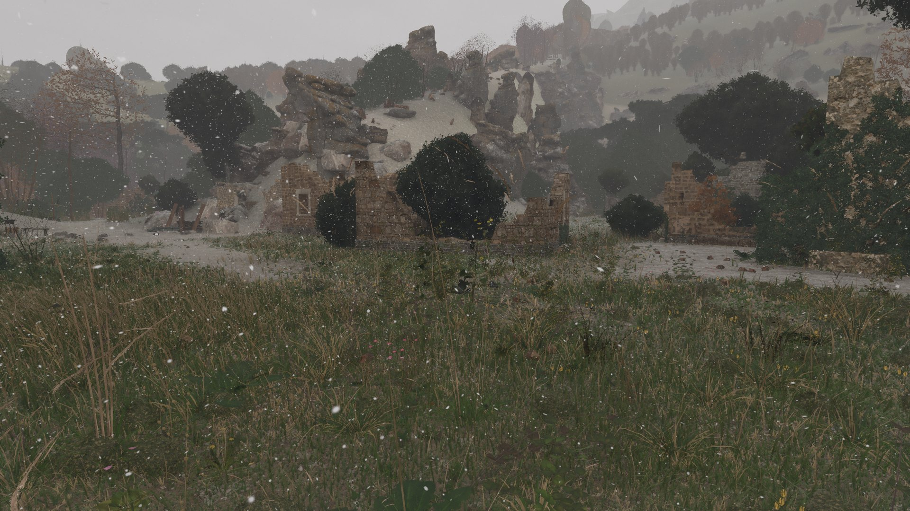</td>
  </tr>
  <tr>
    <td colspan="2"><em>One place, four skies: a grey day breaking, a storm deck, rain and snow. The weather is the
    game's own; the clouds, light and precipitation are the engine's.</em></td>
  </tr>
</table>

<p align="center">
  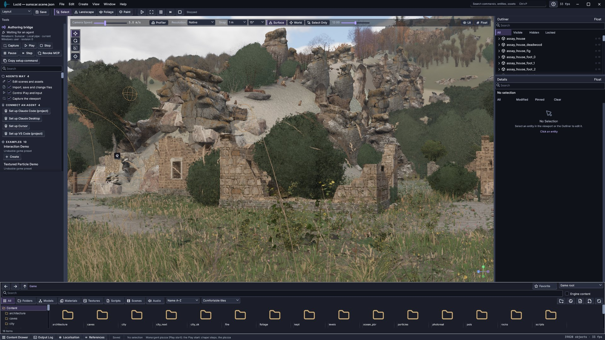
</p>
<p align="center"><em>The editor on Sunscar's world at the Play start, 39,828 objects streamed in.</em></p>

## New in November 2026

What Sunscar has asked of the engine this month. Each item was seen working in the game or the editor.

**In the world**
- **Weather you can stand in.** Rain falls as slanting streaks and snow as soft round flecks of mixed size, drawn as
  lit sprites near the eye that take the sun through its shadow cascades and the sky's light. Storm decks build inside
  the volumetric clouds, and a grey day can break into sunlit cumulus. In dry wind, dust hazes the air.
- **Fire.** Flames burn in tongues, embers rise from open fires, and a lamp's flame casts a soft glow round itself.
- **Big scanned assets.** Thousands of photogrammetry rocks, plants and pieces of dead wood stream in with the cells.
  Imported textures go to the GPU block-compressed (BC7, a quarter of the memory), from a cache on disk that is filled
  once.

**In the editor** (the full list, newest first, is [What's new](docs/editor/whats_new.md), also under
**Help > What's New**)
- **G carries a thing over the ground.** It follows the pointer over whatever lies under it, a roof, a rock or the
  terrain, and a click puts it down.
- **The Content Drawer shows a large game's folders at once,** while the project is still being read.
- **The editor opens a scene at its first place,** where the game starts, and offers an autosave only when it is
  newer than the scene.
- **Help > What's New** lists each round of changes in plain words, newest first.

## Lucid or Somnium?

The two engines share their history up to October 2026 (the last common commit is from 19 October) and the same
licence. Since then each has followed its own games, and fixes move between them by hand in both directions.

| | [Somnium Engine](https://github.com/ReanSchwarzer1/SomniumEngine) | Lucid (this repository) |
|---|---|---|
| Built for | *The Somnus Fracture*: first-person horror in small, dense levels | Sunscar and Rimeborn: open worlds several kilometres across |
| Depth buffer | Forward depth | Reversed infinite depth, camera-relative rays far from the origin |
| Only here | Packed game data for shipping (`somnium_vfs`), video-memory limits and an out-of-memory report, fog cut for hand-held lights | Everything under [What Lucid adds](#what-lucid-adds) |
| Crates | 21, including `somnium_vfs` | 21, including `somnium_life` |

Pick Somnium for compact levels and a pack format you can ship today. Pick Lucid for large outdoor worlds, streaming,
grass, weather and the open-world editing tools.

## What Lucid adds

Each line was checked against the code in this tree. The linked pages explain how to use it.

**Open worlds**
- Streaming for worlds many kilometres across, built on the cell streaming both engines have: terrain tiles stream in
  as cells and reuse renderer slots, each region can wear its own ground layer set, stand-in cells cover far tiles
  while the near ones load, far land loads first, and the first fill reads on several cores. See
  [Open worlds](docs/editor/open_world.md).
- Reversed infinite depth, and camera-relative ray rebuilds and terrain precision, so the ground stays sharp kilometres
  from the world origin.
- Prop sets: thousands of copies of one model as a single entity. See [Prop sets](docs/editor/prop_sets.md).
- Instance batches: copies kept on the GPU, culled and drawn without a per-frame submit, with LOD hand-over by dither.

**Ground and foliage**
- GPU grass: blades laid out on the GPU every frame around the eye from a habitat table per terrain layer, and drawn
  into the visibility buffer. `SOMNIUM_GPU_GRASS=0` turns it off. See [GPU grass](docs/editor/open_world.md#gpu-grass).
- Ground cover by habitat: the near-view cover both engines grow per cell also follows habitat tables per terrain
  layer, and a streamed tile grows the same cover wherever its renderer slot lands.
- A painted tree or shrub can be deleted, or turned into an ordinary object to move and save
  (**Level > Make This an Object**, Ctrl+Shift+O).

**Sky, light and weather**
- Rain, snow and hail near the eye, lightning channels, and storm bodies inside the volumetric cloud march. All are off
  by default and driven by the game; there is no built-in weather director yet.
- Snow lying on surfaces (off by default).
- A moving sun with the sky light rebuilt a few faces a frame, a north offset for the day clock, and the sun forms of
  Sunscar's sky.
- Lamps that are switched, or go out in daylight (above 1,200 lux), real fire, and more than 256 lights in a scene
  (the nearest and brightest 256 are kept, with a fade).
- A photographic camera (fitted tone curves, sky-weighted metering, lens glare, sensor noise) and grading controls: a
  `.cube` LUT, a bloom threshold, eye-adaptation range and rates, low-light vision.

**People and play** (built for Rimeborn)
- `somnium_life`: villagers on daily routines, livestock and carts, with simulation LOD. See
  [Living towns](docs/editor/life.md).
- Isometric interaction: doors that swing and close, talk, take, sit, read, use. See
  [Interaction](docs/editor/interaction.md).
- Switching between two protagonists with a camera lift. See [Protagonist switch](docs/editor/protagonist_switch.md).
- Game save slots in the engine's save format. See [Saves](docs/editor/saves.md).
- Animation LOD and combat brain LOD for crowds.

**Diagnostics** (see [When something goes wrong](docs/editor/diagnostics.md))
- Crash reports: a panic writes `logs/crash-<time>.txt` (build, GPU, driver, backtrace) and shows where it is; a native
  crash (driver, Jolt, Luau) also writes a minidump. The log goes to `logs/editor.log` or `logs/game.log`, with the two
  runs before kept. `SOMNIUM_CRASH_REPORT=0` and `SOMNIUM_LOG_FILE=0` turn them off.
- Models are validated before upload (buffer sizes, accessors, indices, images). A broken model is refused with one log
  line and a toast instead of reaching the GPU, and the status bar, the game screen and the last log line count the
  models that did not load.
- `gltf_check` checks glTF files the way the engine reads them, before you commit them.
- **Level > Check Meshes** lists models that will not load, objects that draw nothing, and rocks open on a side.
  (Census of the World and Select All Using This Model, next to it, are in both engines.)
- Acceleration-structure builds are capped at 2 million triangles a frame, so a loading burst stays inside the
  driver's GPU timeout.

## What both engines can do

A summary. The full list is in [docs/features.md](docs/features.md).

- **Rendering:** visibility buffer with bindless resources and GPU-driven culling; physically based shading; cascaded
  and virtual shadow maps; ReSTIR GI on hardware ray tracing with a DDGI fallback; a real-time path tracer and traced
  reflections; physical sky and volumetric clouds; FFT ocean water; FSR 3 upscaling and frame generation; TAA, SMAA,
  FXAA; order-independent transparency.
- **Terrain and world:** 32-layer terrain with clipmaps and virtual texturing, sculpting and painting, foliage
  painting, voxel worlds, world partition, cell streaming, deterministic asset cook and budgeted residency.
  [Edit layers](docs/editor/open_world.md#edit-layers) keep the changes you make to a generated scene in
  `<scene>.edits.json` and apply them again on every load, in the editor, the game and streamed cells.
- **Simulation:** Jolt physics, Kira audio with binaural output and room acoustics, skeletal animation with blend
  trees and state machines, navigation, a job system with priorities and deadlines, Luau scripting in a sandbox.
- **Editor:** schema-generated Details with undo, one command registry for menus, palette and shortcuts, node graph
  and timeline, gizmos, Content Drawer, autosave and crash recovery, MCP automation, in-editor Help (F1).

## Requirements

- **Windows 10 or 11.** It is the only platform built and tested; CI runs on `windows-latest`.
- **A Vulkan GPU.** The ray-traced features need a driver that exposes ray queries; without them the renderer uses its
  raster fallbacks and the DDGI tier.
- **Rust 1.88**, pinned in [`rust-toolchain.toml`](rust-toolchain.toml).
- **A C++ toolchain** (MSVC Build Tools). Jolt Physics and Luau are compiled from source.

## Build and run

```sh
cargo build --workspace
cargo run -p hello_engine                              # the editor, on the demo project in this repository
cargo run -p hello_engine -- --project <game folder>   # the editor on a game's project
```

A project is a folder with a `game.project.json`. If that file names the game's own editor, `hello_engine` starts that
editor instead. Games live in their own repositories, not in this one.

Other runnable programs:

```sh
cargo run -p vvardenfell                                        # public-API-only sample
cargo run -p somnium_asset --example gltf_check -- [--full] <file or folder>...
cargo run -p somnium_assetcook -- <source-root> <output-root> <cache-root> <plan.json>   # standalone cook
```

Tests and checks:

```sh
cargo test --workspace --lib            # what CI runs
cargo test --workspace -j 1             # everything, including GPU tests; -j 1 avoids LNK1104 link errors on Windows
python tools/ghostfence/run.py          # every gate; --fast skips the test row
```

`.cargo/config.toml` optimises every non-member package in `dev` builds, so a game built against this repository gets
an optimised engine, Jolt and Luau while its own crate keeps fast rebuilds.

## Using the editor

- **Right mouse + WASD/QE** to fly, Shift for speed, right mouse + scroll to change speed.
- **T / R / S** move, rotate, scale. **G** carries the selection over the ground. **Ctrl+Z / Ctrl+Y** undo, redo.
  **Ctrl+S** save.
- **Ctrl+P** command palette. **Ctrl+Space** Content Drawer. **F1** Help.
- **F6** terrain tools, **F8** foliage tools. **File > Import Model…** for glTF/GLB.
- **Play / Pause / Stop** run the scene in the editor.

The full list is in [Shortcuts](docs/editor/shortcuts.md); all editor pages are in [docs/editor](docs/editor/).

## Repository layout

21 engine crates, two example programs and one command-line tool are workspace members.

| Crate | What it holds |
|---|---|
| `somnium_core` | App lifecycle, editor logic, scene schema, scripting host, streaming, edit layers, crash reports |
| `somnium_ecs` | Archetype ECS and reflection (no external dependencies) |
| `somnium_renderer` | wgpu backend, visibility buffer, render passes, terrain, water, grass, weather |
| `somnium_shader` | WGSL module registry, `//!include` composition, variant cache |
| `somnium_jobs` | Job system: priorities, deadlines, cancellation, budgeted drain |
| `somnium_anim` | Skeletons, clips, blend graphs, state machines |
| `somnium_asset` | Vertex type, glTF loader and validation, deterministic cook, residency |
| `somnium_script` | Language-neutral scripting seam (command buffer, budgets) |
| `somnium_script_luau` | Luau backend through `mlua` |
| `somnium_input` | Action maps, control paths, processors, rebinding |
| `somnium_i18n` | CLDR plural and gender rules, fallback chains, key extraction |
| `somnium_audio` | Kira wrapper: buses, attenuation, occlusion, Doppler, binaural output |
| `somnium_physics` | Jolt high-level wrapper |
| `somnium_physics_sys` | Raw Jolt FFI (compiles Jolt C++ at build time) |
| `somnium_ui` | Native wgpu widget tree, editor shell, graph, timeline, theme |
| `somnium_voxel` | Voxel world: chunks, meshing, streaming |
| `somnium_ai` | Headless navigation and decision making |
| `somnium_combat` | Real-time combat and abilities, as a deterministic headless simulation |
| `somnium_character` | Kinematic character movement: walk, run, slopes, jump, mantle, climb, swim |
| `somnium_story` | World state, quests, dialogue, barks and the journal |
| `somnium_life` | Ambient life for open worlds (Lucid only) |

```
examples/hello_engine/   the editor and demo project
examples/vvardenfell/    sample that uses only the public API
tools/assetcook/         standalone cook CLI (workspace member)
tools/                   ghostfence (gates), census, reachability, shadercook, slangcook, somnium_mcp, scene_edits.py, ...
third_party/             wgpu-ffx (FSR 3 upscaler), wgpu-ffx-fg (frame generation in WGSL)
docs/                    editor pages, feature list, history, media
context.md               the living architecture document
dev records/             phase plans, records and evidence
```

## How a frame becomes a pixel

Geometry is rasterized once into identity, not colour. One fullscreen pass then shades each visible pixel exactly
once, so the shading cost follows the framebuffer rather than the scene. [`context.md`](context.md) is the map of the
engine as it is now: start with [Architectural rules](context.md#architectural-rules) and
[Where the frame actually goes](context.md#where-the-frame-actually-goes).

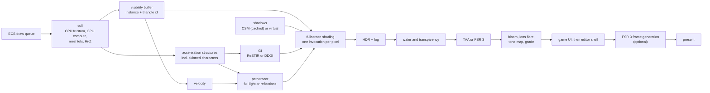

## How it is developed

Frame-time claims come from matched before-and-after `.somtime` runs at a pinned camera; a change inside the noise
band is reported as noise. `tools/ghostfence/run.py` checks the census, the toolchain, shader variant budgets and the
tests. Rejected work stays in the records. The phase ledger and Lucid's history since the fork are in
[docs/history.md](docs/history.md).

## Contributing

See [CONTRIBUTING.md](CONTRIBUTING.md), including which of the two repositories a change belongs in.

## Development with AI assistance

Somnium and Lucid are built with substantial AI pair-programming assistance (Anthropic's Claude, through Claude Code).
The AI is used as an implementation and research partner: reading reference engines, drafting subsystems, running the
measurement harnesses and keeping the architecture docs current. Design direction, review and verification are done by
the author. This is noted for transparency; it has no bearing on how the code is licensed or how you may use it. The
assistant's working files are kept out of version control (see [`.gitignore`](.gitignore)).

## A note on `example_repo/` and ATTRIBUTION.md

[`ATTRIBUTION.md`](ATTRIBUTION.md) and many source comments cite paths inside an `example_repo/` directory (Unreal
Engine, The Forge, Fyrox, Bevy plugins, Jolt, O3DE, Godot, Stride, Wicked and others). That directory is a local,
multi-gigabyte collection of reference repositories, studied for architectural patterns only; no source is copied. It
is not in version control, because of its size and because some references (Unreal Engine and Flax among them) may
not be redistributed. After cloning, the cited paths will be missing; the citations remain as provenance, and nothing
in the build depends on them.

One exception: `somnium_physics_sys/build.rs` compiles [Jolt Physics](https://github.com/jrouwe/JoltPhysics) (MIT)
from `example_repo/JoltPhysics-master/`, so that one subtree is in version control.

## Licence

Licensed under either of, at your option:

- **MIT License** ([LICENSE-MIT](LICENSE-MIT))
- **Apache License, Version 2.0** ([LICENSE-APACHE](LICENSE-APACHE))

Unless you state otherwise, any contribution you submit for inclusion, as defined in the Apache-2.0 licence, is
dual-licensed as above, without additional terms.

Bundled third-party code and assets keep their own licences:

- **Jolt Physics** (in `example_repo/JoltPhysics-master/`): MIT; see its `LICENSE`
- **Luau** (built from source by `mlua-sys`): MIT
- **Inter** and **JetBrains Mono**: SIL Open Font License 1.1
- **Tabler Icons**: MIT
- **Great Lakes height map** (Motion Forge Pictures): CC0 1.0; provenance and source hashes in
  `assets/terrain/great_lakes/README.md`

Every bundled asset, its upstream, version and changes are recorded in
[`THIRD_PARTY_NOTICES.md`](THIRD_PARTY_NOTICES.md); the brand marks' provenance is in
[`crates/somnium_ui/assets/brand/PROVENANCE.md`](crates/somnium_ui/assets/brand/PROVENANCE.md). The Somnium name,
the Eclipse `S` monogram and the engine-specific icons are original project assets and are not covered by the dual
licence above; they have not been through trademark clearance. The Lucid mark and wordmark are original drawings,
recorded in the same provenance file.
