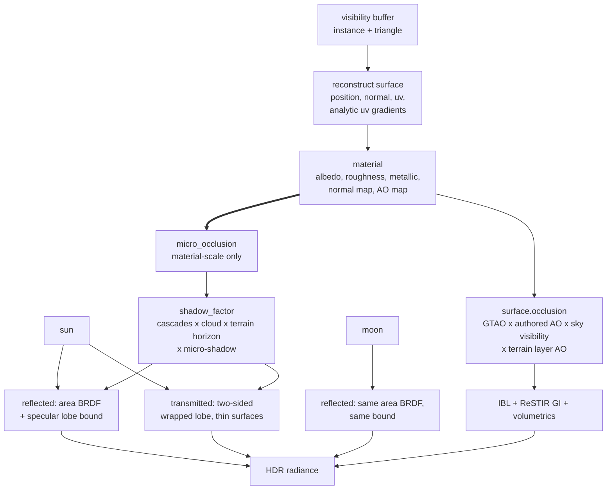

# Development history

This page holds the phase ledger that used to sit in the top-level README. It is kept whole here. Detailed plans,
records and evidence for each phase are in [`dev records/`](../dev%20records/), and the current state of the engine is
described in [`context.md`](../context.md).

Lucid shares this history with [Somnium Engine](https://github.com/ReanSchwarzer1/SomniumEngine) up to October 2026.
Lucid's own work since then is summarised at the end of this page.

## How the project is run

Somnium is developed in codenamed phases. Each phase has a plan, a record of what shipped, and evidence proportionate
to its claims.

### Measurements

`.somtime` files record mean, standard deviation, minimum, maximum, and sample count for GPU and CPU zones after a fixed
warm-up at a pinned camera. Frame changes use matched before and after runs. A delta inside the noise band is reported
as noise.

This has changed decisions. DOOM's tile-specialisation path and aerial terrain split measured slower and stayed off.
PORTAL-0 reverted a WGSL optimization after repeated runs showed a regression.

### Generated checks

`tools/census/generate.py` derives structural counts from the current tree. `tools/ghostfence/run.py` checks census
freshness, the frozen toolchain, shader variant budget, job-system ownership, duplicate singleton systems, golden
images, and workspace tests. A row that cannot run reports `SKIP` with a reason.

### Negative results

Rejected and inconclusive work stays in the record. A phase document separates what was planned, what shipped, what
was deferred, and what evidence refused.

## Phase history

Roughly chronological. Detailed records live in [`dev records/`](../dev%20records/).

| Phase | Codename | What it built | Status |
|---|---|---|---|
| 1–15 | — | Lifecycle, ECS, visibility buffer, shadows, PBR, clustered lights, glTF, voxels, heightmap terrain, GPU-driven rendering | In tree |
| 16 | — | **Scripting** — Luau via `mlua`, sandboxed, with a deferred command boundary and measured budgets | Complete |
| IV | — | Great Lakes landscape and finite water; three-cascade FFT ocean | Complete |
| XV | — | 32-layer terrain material, splat/biome authoring, BC7 packs | XV-A–J complete |
| VV | Halcyon | Ray-traced water reflections and refraction | VV-A–H + VV+1 |
| CR | Crysis | CPU/GPU frustum culling | In engine |
| DF | Daggerfall | Terrain material clipmaps (macro + detail stacks) | In engine |
| 26 / 26-Zeta | Metaphor / Nocturne Atelier | Editor information architecture, then its token and paint layer | In tree |
| 27 | Hades | Editor paint layer, motion, elevation | 27-A–G |
| DOOM | id Tech | **The clock** — GPU/CPU profiler, `.somtime`, pixel census, dynamic resolution | A, B, C, E, F |
| CONTROL | Northlight | **Editor reach** — property seam, asset database, drag-and-drop, viewport control, preferences, scene lifecycle, curves, time of day, clouds, weather, decals | **A–O complete** |
| MORROWIND | NetImmerse | The engine's non-renderer half — see below | **In progress** |
| PORTAL-0 | Source | Performance audit and engineering health | **Complete** |
| TSUSHIMA | Ghost of Tsushima | **Terrain photorealism** — long-range sun shadow, baked sky visibility, sky-lit aerial perspective, a relief normal that survives distance, the BRDF's energy terms, splat boundaries the brush cannot paint, macro colour variance, parallax on cliffs, a 25-entry foliage palette, four kinds of water, and the foliage lighting transport that three earlier phases left unqualified | **A–K in tree**, H's contrast-with-distance open, transmitted moonlight deferred |

### Phase MORROWIND, by track

| Track | Codename | Shipped | Open |
|---|---|---|---|
| 0 | BALMORA | Census, **job system** (priorities, deadlines, cancellation), **shader system** (`//!include` composition, variant cache, hot reload), wgpu 30 | — |
| 1 | VIVEC | **Runtime UI framework** — canvases, anchors, paths and gradients, directional navigation, rich text and IME, motion/springs, accessibility tree (AccessKit) | Text shaping (`cosmic-text`, decided, behind a flag) |
| 2 | CONSTRUCTION SET | **Node graph editor** (material + animation catalogues), **timeline** with embedded curve editor | Docking, virtualisation, play-in-editor, GUI layout editor |
| 3 | HLAALU | **Prefabs**, splines/blockout, rule-driven scattering; generated Details and shared graph authoring | — |
| 4 | SILT STRIDER | **Deterministic asset cook** with content-hashed incremental cache, **budgeted residency** + hot reload, **world partition** with cell-owned entity streaming, **HLOD/impostors** and a floating origin | — |
| 5 | DWEMER | **Skeletal animation** — GPU skinning into the shared geometry pool, clips, blend trees, state machines, sync tracks, **root motion/IK/events/ragdolls**, compression and pose jobs | — |
| 6 | SIXTH HOUSE | **Tiled navigation**, pathfinding, obstacles/agents/links, behavior graphs, Luau tasks and perception | — |
| 7 | RED MOUNTAIN | **Virtual shadow maps**, **portable DDGI** (SDF-traced, no ray query), **virtual texturing** for terrain, **OIT + SMAA** | GPU particles |
| 8 | ALMSIVI | **Input actions** (control paths, processors, rebinding), **audio** (buses, attenuation, occlusion, Doppler), **localisation** (CLDR plurals, fallback chains), **save games/state stack** | Video, final playable slice |

### Planned phases

| Phase | Purpose | State |
|---|---|---|
| PORTAL | Rebase and close engineering-health work not covered by PORTAL-0 | Plan only |
| KENSHI | Measure combined load and publish engine limits before optimizing | Plan only |
| STALKER | Build the player, packaging, mods, product UI, living-world systems, and release proof | Plan only |

See [`context.md`](../context.md) for prerequisites, open work, and the distinction between current capability and
planned design.

## Engine work driven by The Somnus Fracture (September–October 2026)

Before the fork, the engine was driven by a first-person horror game built on it, *The Somnus Fracture*, which lives
outside this repository. Its needs brought:

- a real-time path tracer and ray-traced reflections;
- spot-light cookies and a lens flare;
- skinned characters in the ray-traced scene;
- cached shadow cascades and BC7 texture memory;
- FSR 3 upscaling and frame generation, with runtime frame pacing;
- binaural audio and room acoustics;
- a PS2-style picture mode.

See [what landed](../context.md#engine-work-driven-by-the-somnus-fracture-septemberoctober-2026). At that time
[MORROWIND](../dev%20records/phase_MORROWIND.md) (NetImmerse) remained the open phase for the engine's non-renderer
half.

## What one pixel of the shading pass does (TSUSHIMA-K)

Every visible surface walks the same path. The BRDF is the ordinary part. What matters is that each term carries the
factor deciding when it applies: visibility for anything direct, composition for anything ambient, an energy bound for
anything specular.

Four of those qualifiers were missing until TSUSHIMA-K, and painted foliage is what exposed them. `shadow_factor` did
not reach the transmitted lobe, so leaves glowed through hills. The authored AO map overwrote GTAO instead of
multiplying into it, so grass sat on the ground rather than in it. Moonlight skipped the specular bound the sun had.
The moon's own transmitted lobe is not in the diagram because it was removed: there is no moon-direction shadow to
multiply it by yet, and unshadowed it turned night foliage into green pinpricks. Details in
[TSUSHIMA-K](../dev%20records/phase%20TSUSHIMA/TSUSHIMA-K.md).

## Lucid after the fork (October–November 2026)

Lucid's work since the fork is not organised in codenamed phases. It follows what its games need, first the isometric
RPG Rimeborn and, from late October, the first-person open world Sunscar. In rough order:

- **October (Rimeborn):** `somnium_life` (villagers, livestock and carts with simulation LOD), combat brain LOD,
  animation LOD, isometric interaction (doors, talk, take, sit, read, use), game save slots, the protagonist switch,
  prop sets, and terrain tiles streamed as cells, each region with its own ground layers.
- **Early November (Sunscar):** camera-relative rays and terrain precision far from the origin, reversed infinite
  depth, edit layers that survive regenerated scenes, `gltf_check` and model validation before upload, crash reports,
  eye-adaptation and grading controls, the photographic camera, snow lying on surfaces, the Lucid mark, stand-in cells
  for far tiles.
- **Mid November:** rain, snow and hail near the eye, lightning channels and storm bodies in the cloud march (11 Nov);
  the missing-models count, a moving sun, the day clock's north offset and the sun forms of Sunscar's sky, switched
  lamps (12 Nov); real fire (13 Nov).
- **Late November:** GPU grass (19 Nov); rain in nested boxes with gusts and splashes (26 Nov).

All of the above is on the `sunscar` branch; `main` holds Lucid as of 24 October. Work since 27 November (lit
precipitation sprites, embers, the editor's level-design round) is not published yet. The commit log on `sunscar` is
the full record.
